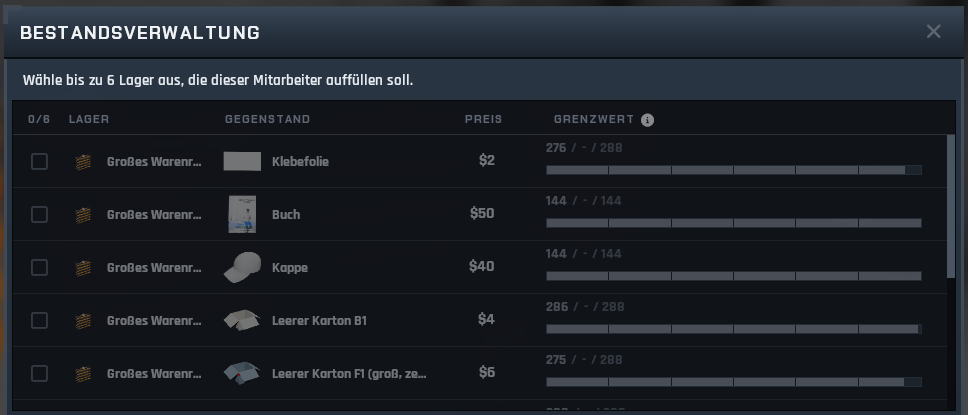

<p align="center">
  
</p>

<p align="center">
  <a href="https://github.com/EuroCent82/Warehouse">GitHub</a>
  &nbsp;·&nbsp;
  <a href="#shelves">Shelves</a>
  &nbsp;·&nbsp;
  <a href="#what-stays">What stays</a>
  &nbsp;·&nbsp;
  <a href="#install">Install</a>
  &nbsp;·&nbsp;
  <a href="#author">Author</a>
</p>

<p align="center">
  A PineLoader mod for Pionero Capital.<br>
  A stock manager with Stock Management II keeps 6 storages stocked.<br>
  With level III, that number is 8. Level I stays at the game's 4.
</p>

<p align="center">
  <a href="https://github.com/EuroCent82/Warehouse"></a>
  <a href="LICENSE"></a>
  <a href="https://github.com/EuroCent82/PineLoader/releases/latest"></a>
  
</p>

<p align="center">
  <a href="https://github.com/EuroCent82/Warehouse/releases/latest"></a>
</p>

The loader is [PineLoader 1.0.4](https://github.com/EuroCent82/PineLoader/releases/latest). The same guide is on [PineLoader.dev](https://pineloader.dev). The picture below is the German game. The sentence in the stock window follows the language of the game. The number in that sentence is also the number of storages the employee can be given.

## Shelves

Stock Management has three levels.

| Level | Storages |
| --- | --- |
| I | 4, the number the game already uses |
| II | 6 |
| III | 8 |

The extra storages are not assigned on their own. The player picks them in the stock window. An employee who already has storages selected keeps those until the player adds more.

<p align="center">
  
</p>

There is one switch, `Enabled`, and it is on. `Enabled=false` puts the limit back to the game's own number.

```ini
[Mod]
Enabled=true
```

## What stays

The vehicle trunk keeps its own limit. Pay, driving, crafting, recruiting, marketing, and the speed of the work stay as the game set them.

## Install

Install PineLoader first, then Warehouse. The same steps are in [instructions.txt](instructions.txt).

### PineLoader

1. Download [PineLoader 1.0.4](https://github.com/EuroCent82/PineLoader/releases/latest). The file is `PineLoader-1.0.4-win-x64.zip`.
2. Unpack it into a folder named `PineLoader` next to the game, so the program is `Pionero Capital\PineLoader\PineLoader.exe`.
3. Close the game and start `PineLoader.exe` once. The loader saves the official file as `PioneroCapital-Win64-Game.exe` and points `PioneroCapital-Win64-Shipping.exe` at itself.
4. Leave the Steam launch options empty. **Play** in Steam starts PineLoader first.

### Warehouse

1. Download [Warehouse 1.0.2](https://github.com/EuroCent82/Warehouse/releases/latest). The file is `Warehouse-1.0.2.zip`.
2. Copy the `Warehouse` folder from that zip into `PineLoader\Mods`. The two files are `Warehouse.dll` and `warehouse-agent.jar`.
3. Start the game through PineLoader. The loader writes `Config\Warehouse.ini` when that file is missing.

## Author

EuroCent82. The site is [PineLoader.dev](https://pineloader.dev). PineLoader is [release 1.0.4](https://github.com/EuroCent82/PineLoader/releases/latest).

## License

Apache License 2.0. The full text is in [LICENSE](LICENSE).
